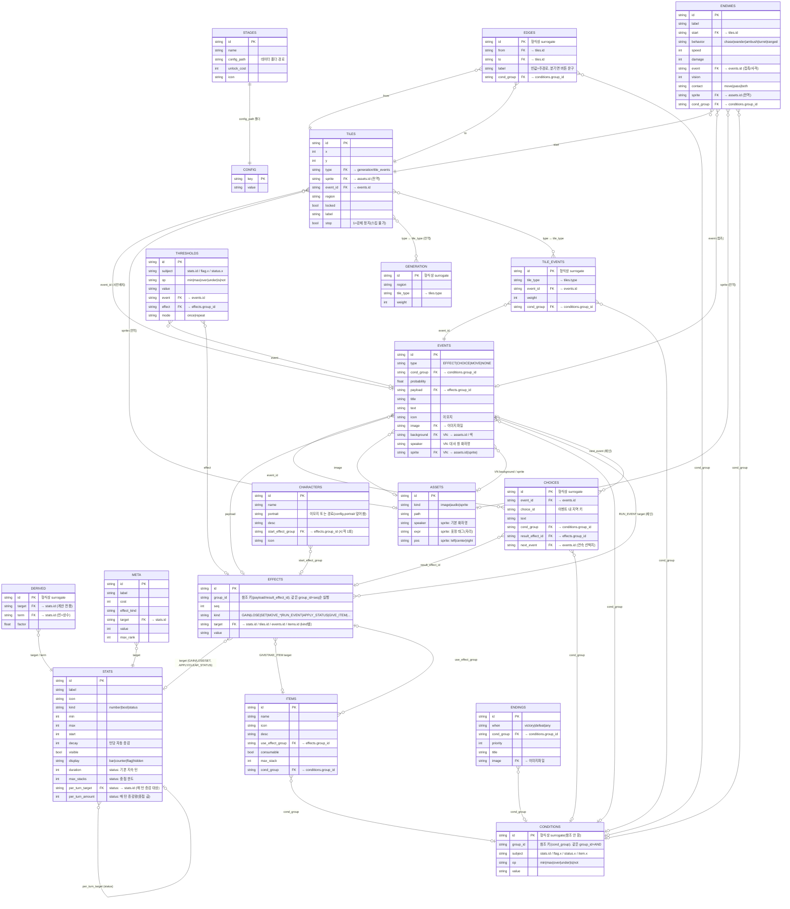

# 데이터 테이블 구조 (ERD)

게임 데이터는 **두 레이어**로 나뉜다(v2). **전역(런) 표**는 `data/` 루트에 한 벌만 두고 모든
스테이지가 공유하며(플레이어가 들고 다니는 정의 + 외부 참조 없는 어휘), **스테이지 표**는
`data/<stage>/` 폴더마다 둔다(이 보드의 배치·스크립트). 아래 다이어그램은 각 테이블이 어떤 열로
다른 테이블을 참조하는지 보여준다. 모든 참조는 문자열 id 매칭이며, 런타임에 `Map`으로 인덱싱해 푼다.

**불변식:** 스테이지 표는 전역 표를 자유롭게 가리켜도 되지만, 전역 표는 스테이지 행을 가리키지 않는다
(그래서 자원·상태가 스테이지를 넘어 이어진다 — `validate`가 이 방향을 강제한다).

- **전역(런):** `STATS` · `DERIVED` · `GENERATION` · `ASSETS` · `STAGES` · `META`
- **스테이지:** `CONFIG` · `TILES` · `EDGES` · `EVENTS` · `CHOICES` · `EFFECTS` · `CONDITIONS` · `TILE_EVENTS` (+선택: `ENDINGS` · `CHARACTERS` · `THRESHOLDS` · `ENEMIES` · `ITEMS`)

각 CSV는 3행 헤더(1행 한글명 / 2행 변수명 / 3행 타입)를 쓴다. 아래 속성 이름은 2행(변수명) 기준이다.
컬럼 설명과 enum은 엑셀 워크북의 `_안내` 시트에도 있다.

## 읽는 순서

1. **STAGES**(전역) → 각 행이 한 스테이지. `config_path`가 가리키는 폴더에 스테이지 표들이 들어 있다.
2. **STATS**(전역) → 플레이어가 들고 다니는 자원·상태. `kind`로 자원(number/bool)과 지속 상태(status)를 가른다. 다른 테이블의 `target`/`subject`가 여기를 가리킨다.
3. **CONFIG**(스테이지) → 그 보드의 시작/목표 타일, 시드, 주사위, 턴 훅, 패배 조건 등.
4. **TILES + EDGES**(스테이지) → 보드의 칸과 연결. `type`/`event_id`가 비면 전역 **GENERATION**으로 채운다.
5. **EVENTS → CHOICES → EFFECTS**(스테이지) → 칸에 도착했을 때 벌어지는 일. effects는 같은 `group_id`를 `seq` 순서로 실행한다. 조건은 **CONDITIONS**를 `cond_group`(→ `group_id`)으로 참조.
6. **GENERATION / TILE_EVENTS** → 빈 칸을 채우는 규칙(전역)과, 타입별 도착 이벤트 풀(스테이지).

## 이벤트 해석 우선순위

칸에 도착하면:

1. `tiles.event_id`가 있으면 그 이벤트 실행 (사전 배치, 1순위).
2. 없으면 `tiles.type`으로 **TILE_EVENTS** 풀에서 조건 통과 행만 추려 가중치 추첨.
3. 그래도 없으면 아무 일도 없음.

## surrogate id 규약

`EDGES`·`GENERATION`·`TILE_EVENTS`·`DERIVED`·`CHOICES`·`CONDITIONS`의 `id`는 행을 가리키는 **형식상
surrogate**다(참조엔 `from/to`·`region/tile_type`·`group_id` 같은 자연키를 쓴다). 의미를 담지 말고
숫자 범위 인덱스(`100001~`)로 적는다. 반면 `tiles.id`·`events.id`·`effects.group_id`·`conditions.group_id`·`stats.id`는
이름으로 가리켜지는 business 키라 의미 있는 이름을 유지한다.

> STAGES·META·STATS·DERIVED·GENERATION·ASSETS는 스테이지 폴더가 아니라 데이터 루트(`public/resources/data/`)에 있는 **전역 테이블**이다.
